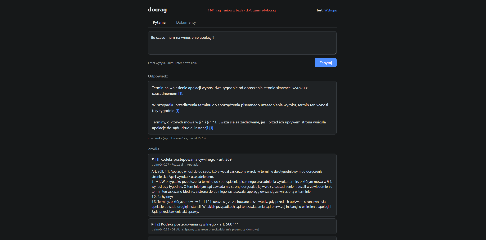
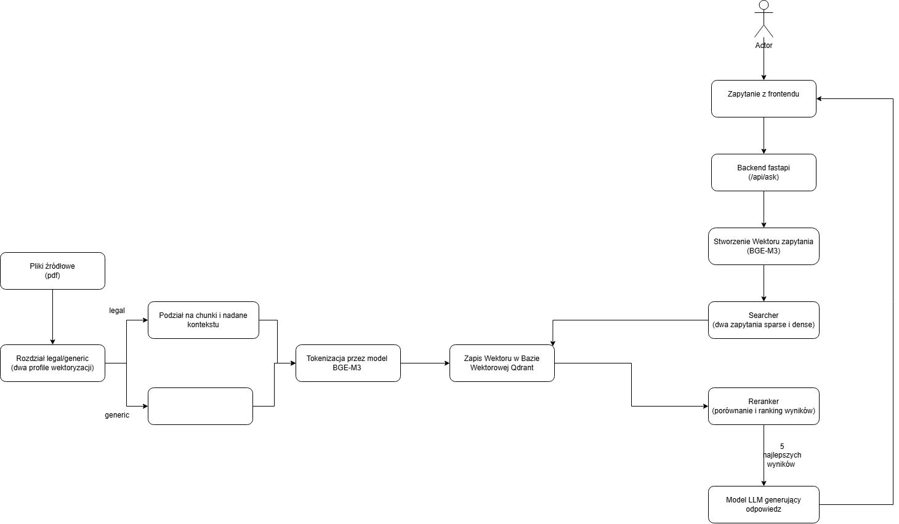
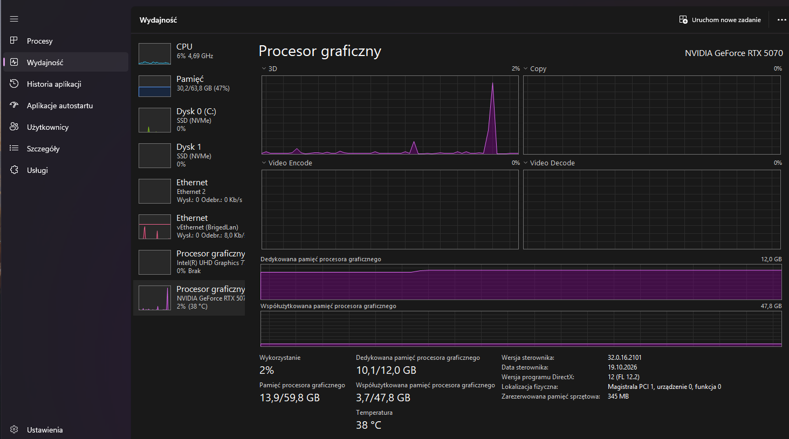

# DOCRAG

> Nazwa robocza – do zmiany.

## Ogólny opis

Program pomaga w organizacji i wyszukiwaniu informacji w dużych zbiorach dokumentów poprzez zapisywanie ich w bazie wektorowej. Obecnie istnieją dwa profile obsługujące dokumenty: jeden ogólny i jeden przystosowany do kodeksów prawa polskiego.

Użytkownik końcowy może:

- **wprowadzić nowy dokument** do bazy – uruchamia to proces zapisu do bazy wektorowej (ingest),
- **wysłać zapytanie** do systemu – uruchamia to proces wyszukiwania i oceniania fragmentów, które następnie trafiają do LLM; użytkownik otrzymuje odpowiedź wraz ze źródłami.



*Rys. 1. Interfejs aplikacji*

## Diagram programu



*Rys. 2. Diagram przepływu danych w programie*

Diagram przedstawia dwa główne przepływy danych, które spotykają się w bazie wektorowej Qdrant: **ingest dokumentów** (lewa i środkowa część) oraz **obsługę zapytania** (prawa kolumna).

### Punkt wejścia

**Użytkownik** korzysta z **frontendu w przeglądarce** (logowanie, pytania, dokumenty), który wysyła pytanie lub plik do **backendu FastAPI** (`/api/login`, `/api/ask`, `/api/documents`). Backend korzysta z **bazy SQLite**, w której przechowuje konta, sesje i rejestr dokumentów (użytkownik, właściciel dokumentu, status przetwarzania).

### Ścieżka 1 – ingest dokumentu

1. **Źródło dokumentu** – dokument trafia do systemu na jeden z dwóch sposobów:
   - **plik wgrany przez stronę** (`POST /api/documents`) – zapisywany w `state/uploads`, przetwarzany w tle, z uprawnieniem `acl` równym `user:<id>` (prywatny) albo `all` (publiczny),
   - **pliki źródłowe z CLI** (PDF, DOCX, MD…, polecenie `docrag ingest`) – z metadanymi i uprawnieniami z pliku `_meta.yaml`.
2. **Wybór profilu** `legal` / `generic` – dwa sposoby podziału dokumentu na chunki:
   - **legal** – odczyt PDF z zachowaniem indeksów górnych, 1 artykuł = 1 chunk, wyciąganie odwołań do innych przepisów (`refs`),
   - **generic** – konwersja Docling → Markdown, podział po nagłówkach.
3. **Dodanie kontekstu** – do treści chunku dołączany jest tytuł dokumentu i ścieżka w hierarchii (np. księga › tytuł › dział › rozdział).
4. **Wektoryzacja BGE-M3** – dla każdego chunku liczony jest wektor gęsty i rzadki.
5. **Zapis do Qdranta** – wektory razem z tekstem i metadanymi.

### Ścieżka 2 – obsługa zapytania

1. **Stworzenie wektora zapytania** – pytanie jest zamieniane na wektory tym samym modelem BGE-M3, którego użyto przy ingeście.
2. **Searcher** – wysyła do Qdranta zapytanie hybrydowe (dense + sparse) z filtrem uprawnień (`acl`: `all` + `user:<id>`), więc użytkownik widzi tylko dokumenty publiczne i własne.
3. **Qdrant zwraca 40 kandydatów** – wyniki obu wyszukiwań połączone fuzją RRF, z zastosowanym filtrem `acl`.
4. **Reranker** – ponownie ocenia 40 kandydatów i wybiera **5 najlepszych wyników**.
5. **Rozszerzenie źródeł + prompt** – znaleziony fragment zastępowany jest całym artykułem, dołączane są przepisy przywołane w odwołaniach, a źródła numerowane jako `[n]`.
6. **Model LLM – Ollama** (opcjonalny) – generuje odpowiedź na podstawie źródeł.
7. **Odpowiedź** wraca do backendu, a stamtąd do frontendu jako odpowiedź + źródła, przesyłane strumieniowo (SSE). Przy wyszukiwaniu bez LLM (`/api/search`) zwracane są same źródła.

## Tworzenie użytkownika

```bash
docker compose -f compose.windows-5070.yml exec -it docrag docrag user add test
docker compose -f compose.windows-5070.yml exec -it docrag docrag user admin test
```

Pierwsze polecenie tworzy konto `test`, drugie nadaje mu rolę administratora.

## Opisy poszczególnych modułów

### Warstwa interfejsu

#### `api.py` – backend

Używając FastAPI jako frameworka i Uvicorna jako serwera, odpowiada za logikę REST aplikacji. Obsługuje: logowanie i token sesji, pobieranie/wgrywanie/usuwanie dokumentów (każdy użytkownik zarządza swoimi dokumentami, administrator może usuwać wszystkie) oraz zadawanie pytań i zwracanie odpowiedzi jako JSON lub strumień SSE.

**Endpointy:**

| Metoda | Ścieżka | Opis |
|---|---|---|
| `POST` | `/api/login` | logowanie, tworzenie sesji i przydzielanie tokenów |
| `POST` | `/api/logout` | usuwanie sesji |
| `GET` | `/api/me` | informacje o zalogowanym użytkowniku |
| `GET` | `/api/documents` | dokumenty użytkownika (admin widzi wszystkie) |
| `POST` | `/api/documents` | wgrywanie pliku przez formularz |
| `DELETE` | `/api/documents/{id}` | usunięcie dokumentu z systemu po id |
| `POST` | `/api/ask` | proste zapytanie |
| `POST` | `/api/ask/stream` | zapytanie zwracające odpowiedź strumieniowo (efekt pisania) |
| `POST` | `/api/search` | wyszukiwanie z pominięciem LLM |
| `GET` | `/api/health` | endpoint techniczny zwracający stan aplikacji (Qdrant, model embeddingów, LLM) |
| `GET` | `/` | frontend dla użytkownika z katalogu `web/` |

#### `cli.py` – interfejs wiersza poleceń

Tekstowe narzędzie administracyjne – pozwala na tworzenie użytkowników, ingest i diagnostykę.

| Komenda | Składnia | Co robi |
|---|---|---|
| `inspect` | `docrag inspect <pliki/foldery> [opcje dokumentu] [--show N] [--out plik.jsonl]` | podgląd chunków bez zapisu |
| `ingest` | `docrag ingest <pliki/foldery> [opcje dokumentu] [--force]` | chunkowanie, embeddingi, zapis do Qdranta |
| `delete` | `docrag delete --doc-id <id>` | usunięcie dokumentu z Qdranta, rejestru SQLite i dysku |
| `stats` | `docrag stats` | liczba punktów i chunków na dokument |
| `search` | `docrag search "<pytanie>" [opcje pytania] [--top N] [--chars N]` | wyszukiwanie + reranker, bez LLM |
| `ask` | `docrag ask "<pytanie>" [opcje pytania] [--show-prompt]` | wyszukiwanie + odpowiedź LLM |
| `serve` | `docrag serve [--host 127.0.0.1] [--port 8008]` | serwer API i frontendu (Uvicorn) |
| `user add` | `docrag user add <login> [--admin] [--password X]` | nowe konto |
| `user passwd` | `docrag user passwd <login> [--password X]` | zmiana hasła |
| `user admin` | `docrag user admin <login> [--off]` | nadanie lub odebranie roli admina |
| `user del` | `docrag user del <login>` | usunięcie konta |
| `user list` | `docrag user list` | lista kont |

### Warstwa logiki

#### `search.py` – wyszukiwanie

Moduł odpowiadający za właściwe wyszukiwanie. Z 40 kandydatów zostaje 5 artykułów i najwyżej 3 źródła pomocnicze. Kolejne kroki:

1. **Wektor pytania.** Pytanie użytkownika trafia do modelu BGE-M3 (`embedder.embed_query()`), tego samego, który podczas ingestu przetworzył dokumenty. Model zwraca dwie reprezentacje naraz. **Wektor gęsty** to 1024 liczby opisujące znaczenie zdania: pytania o tym samym sensie, ale innymi słowami, dostają podobne wektory. **Wektor rzadki** to słownik „token → waga”, który mówi, które słowa pytania są ważne (np. „apel” dostaje dużą wagę, a „w” małą). Użycie tego samego modelu po obu stronach jest konieczne, bo tylko wtedy wektory pytania i dokumentów leżą w tej samej przestrzeni i da się je porównać.
2. **Filtr uprawnień.** Zawęża zapytanie do dokumentów, do których użytkownik ma dostęp.
3. **Wyszukiwanie hybrydowe w Qdrancie.** Metoda `store.search_hybrid()` wysyła jedno zapytanie `query_points`, w którym Qdrant wykonuje dwa niezależne wyszukiwania (tzw. *prefetch*). Pierwsze porównuje wektor gęsty pytania z wektorami fragmentów miarą cosinusową i zwraca 40 najbliższych znaczeniowo. Drugie mnoży wagi słów wspólnych dla pytania i fragmentu i również zwraca 40 wyników.

   Obie listy mają wyniki w różnych skalach (cosinus 0–1 i nieograniczony iloczyn wag), więc nie da się ich po prostu dodać. Dlatego Qdrant łączy je metodą **Reciprocal Rank Fusion**: każdy fragment dostaje sumę odwrotności swoich miejsc w obu listach. Fragment wysoko na obu listach wygrywa, a fragment bardzo wysoko na jednej z nich nadal ma szansę. Z połączonej listy 40 najlepszych fragmentów (`rerank_candidates`) przechodzi dalej.
4. **Ponowna ocena rerankerem.** Wektory porównują pytanie i fragment, które zostały zakodowane osobno. Reranker `bge-reranker-v2-m3` jest cross-encoderem: czyta pytanie i tekst fragmentu jednocześnie i ocenia, na ile ten tekst odpowiada na pytanie, w skali 0–1. Tekst oceniany przez reranker to `Pipeline.embed_text()`, czyli tytuł aktu, ścieżka w jego strukturze i treść fragmentu. Ta ocena jest znacznie dokładniejsza, ale kosztowna, dlatego stosuje się ją tylko do 40 kandydatów, a nie do całej bazy.
5. **Grupowanie fragmentów w artykuły.** Długi artykuł jest w bazie podzielony na kilka fragmentów. Program przegląda kandydatów od najlepszego i przypisuje każdy do jednostki: fragmenty podzielonego artykułu do jego `parent_id`, a pozostałe do własnego `chunk_id`. Pierwsze pięć różnych jednostek (`top_k`) staje się źródłami, kolejne fragmenty tych samych artykułów dołączają do nich, a fragmenty dalszych artykułów są pomijane. `top_k = 5` oznacza pięć różnych przepisów, a nie pięć kawałków jednego.
6. **Od fragmentu do całego artykułu (small-to-big).** Do wyszukiwania lepiej nadają się krótkie fragmenty, bo ich wektor jest bardziej precyzyjny, ale do odpowiedzi model potrzebuje pełnego kontekstu. Dlatego gdy znaleziony fragment jest częścią podzielonego artykułu, a w jego payloadzie zapisano tekst całego artykułu (`parent_text`, do 4000 tokenów), źródłem staje się cały artykuł. Jeśli artykuł jest za długi, źródłem są znalezione fragmenty sklejone w kolejności występowania. Każde źródło dostaje też metadane: typ dokumentu, wersję (np. publikator), datę obowiązywania i plik źródłowy.
7. **Przepisy przywołane (źródła pomocnicze).** Podczas ingestu profil prawny zapisał odwołania do innych przepisów w polu `refs`, więc teraz program przechodzi przez nie, zaczynając od najlepszego źródła, i pobiera z Qdranta brakujące artykuły (najwyżej trzy, `max_refs`).
8. **Wynik.** Metoda zwraca `SearchResult` z listą źródeł głównych, listą źródeł pomocniczych i statystykami: liczbą kandydatów oraz czasem każdego etapu w milisekundach (`ms_embed`, `ms_search`, `ms_rerank`, `ms_expand`). Statystyki trafiają do logów i odpowiedzi API. Przy pytaniu do LLM wynik przejmuje `llm.select_sources()`: wkłada do promptu najpierw źródła główne, potem pomocnicze, dopóki mieszczą się w 6000 tokenów, i numeruje je `[1]`, `[2]` …, żeby model mógł się na nie powołać.

##### Przykład

Dla pytania „Ile mam czasu na wniesienie apelacji?” art. 369 był pierwszy w wyszukiwaniu wektorem gęstym (cosinus 0,723), ale dopiero 13. w wyszukiwaniu słownym (0,0527), bo wyżej znalazł się tam np. art. 390, w którym słowo „apelacja” występuje częściej. Fuzja RRF dała mu 1/2 + 1/14 ≈ 0,571, a reranker, czytając pytanie razem z tekstem „Apelację wnosi się […] w terminie dwutygodniowym”, ocenił go na 0,943. Art. 369 został więc źródłem `[1]`. Pozostałe źródła główne to art. 560^11, 373^1, 343 i 407, a pomocnicze – art. 374 (przywołany w art. 373^1), 342 (w art. 343) i 401^1 (w art. 407).

#### `rerank.py` – ponowna ocena kandydatów

Ocenia każdą parę (pytanie, fragment) cross-encoderem i zwraca wynik 0–1. Jest dokładniejszy od podobieństwa wektorów, bo model widzi pytanie i tekst jednocześnie.

**Technologie:** FlagEmbedding (`FlagReranker`), model `BAAI/bge-reranker-v2-m3` (ok. 568M parametrów, wielojęzyczny), PyTorch + CUDA, fp16.

#### `llm.py` – odpowiedź modelu językowego

Buduje prompt (`SYSTEM_PROMPT` + wiadomość z ponumerowanymi źródłami `[n]` i pytaniem), dobiera źródła w budżecie tokenów (`select_sources`, `context_max_tokens = 6000`) i strumieniowo pobiera odpowiedź z Ollamy (`POST /api/chat`).

**Technologie:** httpx (klient HTTP ze strumieniowaniem, osobny timeout połączenia), JSON lines z Ollamy, model Gemma 4 E4B (`gemma4-docrag`).

**Rola:** ostatni etap RAG (*generation*). Model ma odpowiadać tylko na podstawie źródeł i cytować je jako `[n]`; numeracja źródeł w prompcie jest ta sama co w odpowiedzi API.

#### `documents.py` – dokumenty użytkowników

`DocumentService`: wgranie pliku (sprawdzenie formatu, zapis do `upload_dir`, limit MB), ingest w tle, lista dokumentów, usuwanie (właściciel albo admin) i synchronizacja z Qdrantem dokumentów wgranych przez CLI.

**Technologie:** `ThreadPoolExecutor(max_workers=1)` (kolejka ingestu), `secrets` (losowy sufiks `doc_id`), `pathlib`.

### Pipeline ingestu (zapis dokumentu do wektorowej bazy danych)

#### `pipeline.py` – orkiestracja ingestu

Dla każdego pliku: zbiera metadane (`_meta.yaml` z katalogów, plik `*.meta.yaml` obok dokumentu, opcje z CLI/API), wybiera profil, tnie na chunki, buduje payload, liczy embeddingi paczkami po 64 i zapisuje do Qdranta.

**Technologie:** PyYAML (metadane), hashlib SHA-256 (`doc_hash`), dataclasses, logging.

**Rola:** jedyne miejsce, które zapisuje dokumenty do bazy wektorowej. Definiuje schemat payloadu i tekst do embeddingu (`context + text`), ten sam przy ingeście i rerankingu.

#### `converters.py` – konwersja plików do tekstu

`read_legal_lines()` czyta PDF aktów prawnych znak po znaku: rozpoznaje rozmiar tekstu podstawowego, zachowuje indeksy górne (`Art. 505^1`) i odrzuca przypisy. `to_markdown()` zamienia dowolny dokument (PDF, DOCX, PPTX, HTML, XLSX) na Markdown z nagłówkami.

**Technologie:** pdfplumber (pozycje i rozmiary znaków), Docling (opcjonalny, konwersja z zachowaniem struktury).

**Rola:** pierwszy krok ingestu. Od jakości tego kroku zależą numery artykułów, a więc identyfikatory chunków i odwołania.

#### `profiles/` – chunkowanie według typu dokumentu

- **`base.py`** – `Profile`: `detect(sample, path)` zwraca pewność 0–1, `chunk(path, meta)` zwraca `ChunkResult`, `parent_or_none()` zachowuje tekst rodzica do `parent_max_tokens = 4000`.
- **`__init__.py`** – rejestr `PROFILES` (nazwa → klasa). Nowy typ dokumentów = nowa klasa dopisana do słownika.
- **`legal.py`** – profil polskich aktów prawnych. Parser wyrażeń regularnych rozpoznaje hierarchię CZĘŚĆ > KSIĘGA > TYTUŁ > DZIAŁ > Rozdział > Oddział, artykuły (lub § w rozporządzeniach), paragrafy, ustępy i punkty. Chunk = artykuł; artykuł dłuższy niż 700 tokenów jest dzielony po §/ustępach z artykułem jako rodzicem. `extract_refs()` wyciąga odwołania wewnętrzne („art. 342”, zakresy „art. 10–15”) i pomija odwołania do innych ustaw. Oznacza przepisy uchylone (`repealed`) i wykrywa tytuł aktu.
- **`generic.py`** – profil ogólny: Markdown → drzewo nagłówków → sekcje. Tabele, kod i listy to bloki niepodzielne; małe sąsiednie sekcje są sklejane, duże dzielone z sekcją jako rodzicem. Odwołania pochodzą z linków Markdown.

**Rola:** decyduje o jednostce wyszukiwania. Dzięki profilowi prawnemu źródłem odpowiedzi jest cały artykuł ze ścieżką w strukturze aktu, a nie przypadkowy fragment strony.

#### `splitting.py` – liczenie tokenów i dzielenie tekstu

`TokenCounter` liczy tokeny tokenizerem BGE-M3 (bez niego stosuje przybliżenie 3,3 znaku na token). `split_text()` dzieli po zdaniach z zakładką 1 zdania, `hard_split()` tnie po słowach, gdy zdanie jest za długie, `pack_blocks()` skleja bloki do limitu.

**Technologie:** transformers (`AutoTokenizer`).

**Rola:** pilnuje limitów – 700 tokenów na chunk przy ingeście i 6000 tokenów źródeł w prompcie.

#### `embedding.py` – wektoryzacja

Zamienia teksty na wektory: `embed_passages()` przy ingeście, `embed_query()` przy pytaniu (z osobnymi prefiksami). BGE-M3 zwraca naraz wektor gęsty (1024 wymiary) i rzadki (wagi tokenów).

**Technologie:** FlagEmbedding (`BGEM3FlagModel`), opcjonalnie sentence-transformers (np. mmlw-roberta-large, tylko dense), PyTorch + CUDA, fp16.

**Rola:** wspólny model dla ingestu i wyszukiwania. Ten sam model po obu stronach jest warunkiem porównywalności wektorów.

#### `utils.py` – narzędzia wspólne

`normalize_superscripts()` ujednolica zapis indeksów (`505¹`, `505[1]` → `505^1`), `slugify()` tworzy identyfikatory ASCII, `sha256_file()` / `sha256_bytes()` liczą skróty, `split_sentences()` dzieli tekst na zdania z uwzględnieniem listy skrótów prawniczych.

**Technologie:** re, unicodedata, hashlib.

**Rola:** spójne nazewnictwo – ten sam zapis „art. 505^1” w tekście, w `chunk_id` i w odwołaniach pozwala dopasować odwołanie do artykułu.

### Dane i konfiguracja

Dwie bazy mają rozdzielone role: Qdrant (`store.py`) przechowuje treść i wektory, SQLite (`db.py`) – użytkowników, sesje i rejestr dokumentów. Łączy je `doc_id`. `models.py` definiuje struktury danych i konfigurację dla wszystkich modułów.

#### `store.py` – baza wektorowa Qdrant

`QdrantStore` tworzy kolekcję z wektorem gęstym `dense` (1024, cosinus) i rzadkim `sparse` oraz indeksami keyword (`doc_id`, `acl`, `chunk_id`, `parent_id`, `article` i inne). Zapisuje punkty paczkami (`upsert`, `id = uuid5("docrag:" + chunk_id)`), usuwa dokument (`delete_doc`), sprawdza hash (`get_doc_hash`), wykonuje zapytanie hybrydowe (`search_hybrid`: dwa `Prefetch` + `FusionQuery(RRF)`), pobiera artykuły po id (`fetch_units`) i liczy dokumenty (`doc_summaries` przez facet).

`SearchFilter` opisuje uprawnienia i zawężenia: grupy użytkownika (zawsze z `all`), `doc_ids`, `doc_types`. `matches()` robi to samo w Pythonie dla atrap w testach.

**Technologie:** qdrant-client (tryb serwerowy przez URL albo lokalny katalog `qdrant.path`), uuid5.

**Rola:** warstwa trwałego zapisu. Tu realizowane są wyszukiwanie hybrydowe i kontrola dostępu na poziomie fragmentu.

#### `db.py` – SQLite: użytkownicy, sesje, rejestr dokumentów

Trzy tabele:

- `users` – z `AUTOINCREMENT`, żeby id usuniętego konta nie wróciło i nie przejęło jego dokumentów (`user:<id>`),
- `sessions` – sam skrót SHA-256 tokenu i data ważności,
- `documents` – właściciel, tytuł, ścieżka pliku, widoczność, status (`processing` / `ready` / `error`), liczba chunków.

Operacje: konta, logowanie, sesje, CRUD dokumentów, `fail_unfinished()` po restarcie.

**Technologie:** sqlite3 (WAL, klucze obce), `hashlib.scrypt`, `hmac.compare_digest`, `secrets.token_urlsafe`.

**Rola:** przechowuje informację, kto jest użytkownikiem lub adminem i do kogo należy dokument. Treści dokumentów tu nie ma.

#### `models.py` – struktury danych i konfiguracja

Definiuje obiekty przekazywane między modułami (`DocMeta`, `Chunk`, `ChunkResult`) i całą konfigurację: `QdrantCfg`, `EmbeddingCfg`, `ChunkingCfg`, `LegalCfg`, `DefaultsCfg`, `SearchCfg`, `LLMCfg`, `ApiCfg`, zebrane w `Config`. `Config.load()` wczytuje YAML i nakłada go na wartości domyślne.

**Technologie:** dataclasses, PyYAML.

**Rola:** wspólny język programu. Wszystkie parametry (700 tokenów, `top_k` 5, `prefetch_limit` 40, `num_ctx` 8192) mają tu jedno źródło i opis.

## Zużycie zasobów



*Rys. 3. Zrzut menedżera zadań wykonany podczas działania aplikacji (obsługi zapytania) – NVIDIA GeForce RTX 5070, ok. 10,1 / 12 GB dedykowanej pamięci GPU*
